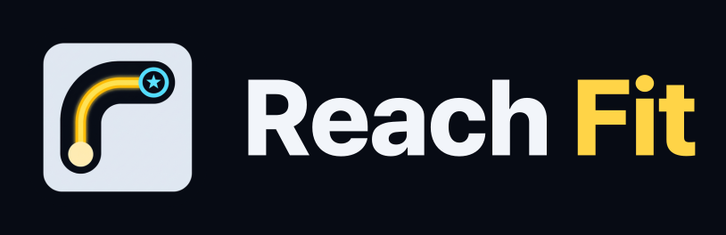

# Reach Fit



A seated mixed reality light puzzle for Meta Quest, built with the Immersive
Web SDK (IWSDK, WebXR). Sweep one hand across the table once and the puzzle
board is laid out along that arc. Tiles keep their size; only the board's
shape changes. Turn tiles with a pinch, by looking at them for 0.8 s (head
gaze), or, with the opt-in Voice button, by looking at one and making a short
sound, to send light to the goal.

Status: plays end to end in the IWSDK emulator (Immersive Web Emulation Runtime).
Not yet verified on Quest hardware.

## Run

```sh
npm install
npm run dev        # IWSDK managed browser with the emulator (room: home_office), port 8081
npm run typecheck
npm run build      # dist/, a static site to host anywhere over HTTPS
node --test 'tests/**/*.test.ts'
node scripts/check-levels.ts    # every level solvable, fewest turns
node scripts/contrast-check.ts  # color pairs against WCAG AAA
node scripts/check-i18n.ts      # keys and placeholders in all languages
```

To play, open the hosted page in the headset browser and enter the immersive
session with the button the browser shows (the page offers the session through
WebXR `offerSession`; there is no Start button on the page).

## How it plays

| Step | What happens | Source |
|---|---|---|
| Table | The board sits on a detected horizontal plane between 0.6 and 0.9 m high, then a hit test, then the height of the hand sweep (lowest quarter of the fingertip samples, minus 8 mm), then a virtual table at 0.72 m. | `src/xr/table.ts` |
| Reach | Sweep one hand across the table. The app fits an arc to the finger tip path and lays the board along it. A path that is not an arc is rejected and the app asks for one more sweep. | `src/xr/calibrate.ts`, `src/xr/arc.ts` |
| Reach without hands | If no hand shows up within 10 s, look at the left edge, then the right edge, and hold each for 0.8 s. If that fails too, a default width is used. | `src/xr/calibrate.ts` |
| Tile size | Tile spacing (center to center) stays 5.5 cm on every arc, so tiles keep one size. | `src/xr/arc.ts` `TILE_SIZE`, `TILE_VISUAL_RATIO` |
| Turn | Pinch a tile, or look at it for the look time (0.8 s by default) while a ring fills. A tile under a held gaze turns again after 1.5 look times. Both inputs are always on. A look that was already resting where the board and panel appear does not act until it leaves and comes back. While a hand is pinching right over a tile, panel buttons ignore presses, and the settings row takes no touch press (it sits right behind the far row, so a finger reaching a far tile could touch it). A controller trigger also selects (in code, not tested). On the flat page (no XR), a mouse click or the keyboard: arrow keys move a highlight over the turnable tiles and the buttons, Enter or Space acts. | `src/xr/pinch.ts`, `src/xr/dwell.ts`, `src/xr/layer.ts` |
| Levels | 12 levels (the first is a one-turn tutorial), then a daily board from a date seed. Best turns are saved in the browser; if storage fails, the game still runs. | `src/puzzle/` |
| Access row | Second row of the panel, always on show and pressable by a ray pinch, gaze, sound or the keyboard (no touch press): Contrast (Standard, Max, Dim), Look time (0.8, 1.2, 2.0, 0.5 s; also the edge hold of the gaze reach setup), Mic sensitivity (Medium, High, Low) with a loudness meter. Saved in the browser (`reachfit.access.v1`). | `src/xr/access.ts`, `src/xr/view.ts`, `src/theme/palette.ts` |
| Look and sound | High contrast theme in three modes, goal drawn as a ring with a star, light path in yellow. Each tile turns with its own note from its own position (HRTF panner). 6 sound effects synthesized with Web Audio, no audio files. | `src/theme/`, `src/audio/` |
| Language | 10 interface languages, switched with the language button in XR. Text is drawn to canvas textures with system fonts. | `src/i18n/`, `src/xr/text.ts` |

## Layout

| Path | What |
|---|---|
| `src/puzzle/` | Rules engine: tiles, light tracing, 12 levels, daily board, save. Plain TypeScript. |
| `src/xr/` | Reach sweep, arc board, pinch and gaze input, sound confirm (`voice.ts`), table fallback, in-XR panel text. |
| `src/ui/` | The 2D page (Start, play log download, start over). |
| `src/game/` | Level flow, theme and language wiring, autorun bridge (dev server only). |
| `src/theme/`, `src/audio/` | High contrast look, positional sound, synthesized effects, WAV export for video editing. |
| `src/i18n/` | Interface text. `en.json` is the source of keys. |
| `src/logger.ts` | Play log: frame intervals, reach samples, mis-grabs, level times, input per action. Download from the 2D page. |
| `src/test-api.ts` | `window.__reachfit` contract used by the autorun and capture scripts. |
| `src/capture/` | Frame-stepped clock, loaded only when `VITE_CAPTURE=1`. |
| `tools/autorun/` | Emulator autorun and picture scripts (see its README). |

## Emulator autorun results

`tools/autorun/autorun.sh` plays every level in the IWSDK emulator through the
IWSDK CLI with synthetic input. Raw results:
`artifacts/autorun-pinch-20261115.json` and `artifacts/autorun-gaze-20261115.json`
(run 2026-11-15 on the build with the access row, Mac, headless browser; the
first runs, 2026-11-11, are `artifacts/autorun-*-20261111.json` with the same
outcome). Both runs use the default settings (contrast Standard, look time 0.8 s).

| Run | Input | Solved | Console errors | Page reloads | Reach set by |
|---|---|---|---|---|---|
| pinch | synthetic right hand, pinch over each tile | 13/13 (L01 to L12 and the daily board) | 0 | 0 | hand sweep, radius 0.45 m, -38.9 to 39.8 degrees |
| gaze | head gaze only; both hands and both controllers disconnected | 13/13 (L01 to L12 and the daily board) | 0 | 0 | gaze edges, radius 0.45 m, -35 to 35 degrees |

Per level (2026-11-15 runs). "ms" is from level start to solve and includes the CLI's own
latency between script steps, so it is not a human play time.

| Level | Fewest turns | Pinch: solved | turns | mis-grabs | ms | Gaze: solved | turns | mis-grabs | ms |
|---|---:|---|---:|---:|---:|---|---:|---:|---:|
| L01 | 1 | yes | 1 | 0 | 4516 | yes | 1 | 0 | 1588 |
| L02 | 2 | yes | 2 | 0 | 4517 | yes | 2 | 0 | 2717 |
| L03 | 3 | yes | 3 | 0 | 7821 | yes | 3 | 0 | 3900 |
| L04 | 4 | yes | 4 | 0 | 10655 | yes | 4 | 0 | 5217 |
| L05 | 5 | yes | 5 | 0 | 12483 | yes | 5 | 0 | 6436 |
| L06 | 6 | yes | 6 | 0 | 13349 | yes | 6 | 0 | 7667 |
| L07 | 6 | yes | 6 | 0 | 13099 | yes | 6 | 0 | 7667 |
| L08 | 7 | yes | 7 | 0 | 20889 | yes | 7 | 0 | 8833 |
| L09 | 9 | yes | 9 | 0 | 20532 | yes | 9 | 0 | 11333 |
| L10 | 10 | yes | 10 | 0 | 23618 | yes | 10 | 0 | 12567 |
| L11 | 11 | yes | 11 | 0 | 24783 | yes | 11 | 0 | 13833 |
| L12 | 11 | yes | 11 | 0 | 24515 | yes | 11 | 0 | 13867 |
| Daily board | 8 | yes | 8 | 0 | 16377 | yes | 8 | 0 | 10133 |

The script picks each turn from the solver's answer, so turns equal the
fewest possible by construction. A mis-grab is a proxy the app counts: a
select on a tile that cannot turn, or a turn undone within 2 s. The pinch
run's app log has one entry of type `error`, "reach sweep rejected:
no-circle": the first samples, taken while the hand came down to the start
point, did not fit an arc, and the next sweep set the reach. The browser
console had no errors.

## Accessibility

Written against the contest's Best Accessibility Forward Experience text. Each row says where it lives in the code and what has and has not been checked.

| Point | What the app does | Source | Checked |
|---|---|---|---|
| Voice alternatives for hand interactions | Opt-in Voice button. With the microphone open, a short loud sound while the look rests on a tile or button acts at once, without waiting out the look time. Loudness only, no speech recognition, nothing recorded or sent. A sound that lasts over 0.9 s is treated as room noise. Mic sensitivity: Medium (default), High (a soft voice in a quiet room), Low (ignores a cough in a loud room). A meter above the Mic button shows each sound as a share of the trigger level and turns yellow when it counts. No microphone: the panel says so and points to Look time. | `src/xr/voice.ts`, `src/xr/layer.ts`, `src/xr/access.ts` | 9 unit tests with synthetic loudness (5 for the gate, 4 for the levels and the meter). Emulator capture with a synthetic microphone. Quest microphone permission not checked. |
| Eyes-only navigation | Head gaze is always on beside the pinch: every turnable tile and every button, the access row included, acts after a look. Look time 0.5, 0.8 (default), 1.2 or 2.0 s; repeats on a held tile every 1.5 look times. Setting the reach works without hands (left edge, right edge), with the same hold time. | `src/xr/dwell.ts`, `src/xr/calibrate.ts`, `src/xr/access.ts` | Unit tests for 2.0 s and 0.5 s looks and the 2.0 s edge hold. Emulator autorun with hands and controllers disconnected (see above). No person has tried it. |
| High-contrast modes | Three modes on the Contrast button. Standard (default): the look described in `src/theme/palette.ts`. Max: pure black and white faces and base, saturated marks, white buttons, no pulse. Dim: lower brightness for light-sensitive players, no pulse. The goal has its own shape in every mode. | `src/theme/palette.ts`, `src/theme/materials.ts`, `scripts/contrast-check.ts` | 21 touching color pairs (button labels and outlines included) in each mode against WCAG AAA 7:1, 0 failures. Lowest pair: Standard 8.12:1, Max 13.41:1, Dim 7.66:1. |
| Inclusive by default | No menu: the settings sit on the panel and are saved in the browser. The board follows the player's reach, tile size stays fixed, no controller needed, each tile has its own note from its own place, 10 interface languages. No table found: the board sits at the height of the hand sweep. No headset: the same board plays on the flat page with a mouse or the keyboard. | `src/xr/arc.ts`, `src/xr/table.ts`, `src/xr/layer.ts`, `src/audio/`, `src/i18n/` | Emulator and unit tests only. Translations not reviewed by native speakers. Flat page keyboard play: checked on the production build in headless Chrome (a keyboard turn solved level 1, 0 console errors, nothing pressed by itself in 4 s idle) and recorded in the capture run (`capture/scenes.mjs` session K, level 3 solved by three keyboard turns). |

### W3C XR Accessibility User Requirements

Checked against the W3C Working Group Note "XR Accessibility User Requirements" (25 August 2021). Only the requirements this app touches are listed.

| Requirement | Status here |
|---|---|
| REQ 2a: act in the environment without doing it physically | Yes: head gaze for every tile and button, sound confirm, gaze reach setup. |
| REQ 2b: every part of the interface through the same input method | Yes: pinch, head gaze, and (on the flat page) the keyboard each reach every tile and button. |
| REQ 2c: several input methods at the same time | Yes: pinch and gaze are always on together, sound is added on top. |
| REQ 5a: navigation and interaction by voice activation | In part: a sound confirms what the look picked; there are no spoken commands. |
| REQ 6a: high contrast skins for luminosity and color contrast | Yes: three contrast modes, all pairs at WCAG AAA. |
| REQ 15b: timings for interactions can be changed or extended | Yes: look time 0.5 to 2.0 s, also for the reach setup. |
| REQ 1b: controls support rearranging position and sensitivity adjustment | In part: the board takes the player's reach and the mic sensitivity has three levels; buttons cannot be moved. |

## Limits

- Quest hardware: run on a headset 0 times. Everything above is the emulator
  with synthetic head and hands.
- People: 0 testers, with or without limited reach. Nothing here says how
  comfortable or fast the game is for a person.
- Frame rate on a headset: not measured. The log records emulator frame times
  in a desktop browser; they say nothing about Quest performance and are not
  reported.
- Table detection was seen only in the emulator's `home_office` room.
- Voice button: loudness gate on the microphone (`src/xr/voice.ts`), not speech recognition. Unit tests use synthetic loudness; the Quest browser's microphone permission is untested. The three mic levels are design values, not measured in real rooms.
- Table from the hand sweep: tested with synthetic heights only. The emulator room always reports its desk plane, so this path has not run in the emulator either.
- Head gaze, not eye tracking: the dwell follows where the head points.
- UI text: English (`src/i18n/en.json`) is the source. The other 9 languages
  were machine translated (Qwen3-235B-A22B-Instruct-2507 on Nebius Token
  Factory). Korean, Japanese, Simplified Chinese and Traditional Chinese were
  then read and edited by Claude (an AI model). Spanish, French, German,
  Portuguese (Brazil) and Vietnamese are machine translation with a few clear
  errors fixed. No native speaker has reviewed any language yet.
- `node scripts/check-i18n.ts` checks keys, `{placeholders}`, empty values,
  values left in English, em dashes and button length. It does not check
  meaning or tone.
- A font-fit script kept outside this repo measures every in-XR message, status line
  and button label in all 10 languages with the same wrap and shrink rules as
  `src/xr/text.ts`, using the Mac Chrome fonts. The headset browser has other
  fonts, so the real check is the emulator capture.

## Credits

- Logo: the mark was generated with a Gemini image model and edited by hand (the target star redrawn as the game's five-point star). Wordmark set in Pretendard (SIL OFL 1.1). Files in `public/brand/`.
